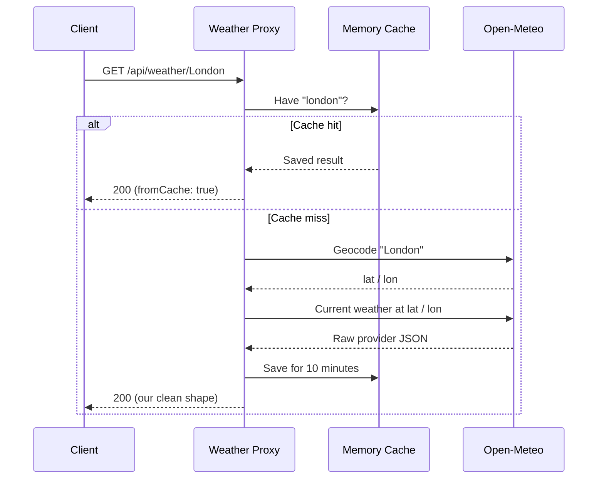

# 🌦️ Weather Proxy API


> Ask for a city. Get clean weather. Never think about the provider's messy JSON.

A small API that sits between your app and a third-party weather service
([Open-Meteo](https://open-meteo.com), no API key needed). It looks up the city, fetches the
weather, reshapes the data, caches it, and fails politely when the provider is down.

I built it to learn how real backends talk to other people's APIs.

## ✨ Features

- One simple endpoint: `GET /api/weather/{city}`
- Two provider calls (city → coordinates → weather) hidden behind one response
- **10-minute cache**, so repeat requests are instant and the provider isn't hammered
- **5-second timeout**, so a slow provider can't hang the API
- Clear errors: `400`, `404` and `502`, each with a meaning
- Tested **without internet** using a fake HTTP handler

## 🔌 Try it

```bash
curl http://localhost:5000/api/weather/London
```

(Use the port `dotnet run` prints.)

```json
{
  "city": "London",
  "country": "United Kingdom",
  "temperatureC": 12.5,
  "windSpeedKmh": 9.0,
  "condition": "Partly cloudy",
  "fetchedAtUtc": "2026-10-19T09:30:00Z",
  "fromCache": false
}
```

Call it again within 10 minutes and `fromCache` flips to `true`.

## 🧭 What happens on a request



## 🚦 Status codes

| Situation | Response |
|---|---|
| City found | `200 OK` |
| Empty or over-long city name | `400 Bad Request` |
| City doesn't exist | `404 Not Found` |
| Provider down, slow or returning junk | `502 Bad Gateway` |

`502` is deliberate: the problem is upstream, not in this API, and clients should know that.

## 🚀 Run it

```bash
git clone https://github.com/raghava503/WeatherProxy.git
cd WeatherProxy
dotnet run --project WeatherProxy.Api
```

Run the tests:

```bash
dotnet test
```

## 🏗️ Project structure

```text
WeatherProxy/
├── WeatherProxy.Api/     minimal API, service and models
└── WeatherProxy.Tests/   xUnit tests with a stubbed HTTP handler
```

## 🧪 Tested scenarios

- Provider data is mapped correctly to our response shape
- An unknown city returns nothing, which the endpoint turns into a `404`
- A second request (even with different casing) comes from the cache, with only 2 provider calls instead of 4
- A provider `500` surfaces as an exception, which the endpoint turns into a `502`
- Weather codes translate to readable conditions

No test touches the real internet, so they're fast and never flaky.

## 🧠 What I learned building this

- **`IHttpClientFactory` and typed clients**: why `new HttpClient()` per request exhausts sockets
- **Timeouts and cancellation**: protecting my API from slow dependencies
- **Anti-corruption layer**: my own `WeatherResponse` keeps provider changes away from clients
- **JSON mapping**: `[JsonPropertyName]` turns `temperature_2m` into a normal C# property
- **Caching**: `IMemoryCache`, normalised keys, and expiry
- **Records and `with`**: copying an immutable object with one change
- **Pattern matching**: switch expressions

## 👤 Author

**Raghava**: aspiring full stack .NET developer
[GitHub](https://github.com/raghava503) · [LinkedIn](https://linkedin.com/in/raghava-gudiwada-0b2bb4317)